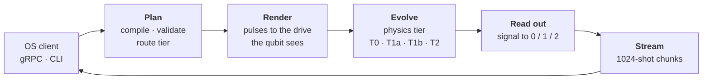

# QCSS: Quantum Control Stack Simulator

[](https://github.com/PratulDeshpande/qcss/actions/workflows/ci.yml)
[](LICENSE)
[](pyproject.toml)

QCSS stands in for real quantum control hardware (Qblox, Zurich Instruments SHFQC+, QICK) so a
quantum operating system can be developed and tested against it. The OS talks to QCSS over gRPC
exactly as it would to the instruments: it submits pulse-level jobs, sees hardware-rule violations
with field paths, calibrates mixers, flux predistortion and readout against hidden "true"
impairments, and receives chunked, seeded results.

Two ideas make it useful rather than a toy:

1. **It enforces real hardware rules.** Every constant (timing grid, waveform memory, feedback
   latency) comes from a YAML profile of a real instrument, and each value records its source.
2. **It hides the truth.** A simulated mixer can have a secret gain imbalance. The OS has to
   *calibrate* it away, as it would on real hardware, instead of being handed the answer.

> **Status: alpha (0.1.0).** The simulator core, gRPC service and four physics tiers are
> implemented and tested. Vendor adapters (Qibolab, Qblox, QCoDeS) are not built yet. See
> [Limits](#limits).

## How a job runs



1. **Plan (at `SubmitJob`).** Sweeps are expanded; every point is compiled and checked against the
   hardware profile (grids, minimum durations, waveform memory, NCO rules, acquisition limits,
   feedback timing including time of flight and routing latency, DAC saturation). Pulses are lifted
   to their actual unitaries and the job is routed to a fidelity tier. Refusals come back before a
   job id exists: `INVALID_ARGUMENT` for hardware violations, `FAILED_PRECONDITION` for a tier that
   cannot run the job or a stale calibration epoch.
2. **Render.** Each play is rendered on the generator's sample grid: frame phase from the NCO model
   (virtual Z, `set_phase`, `set_frequency`), the OS's IQ correction, the hidden mixer truth and LO
   leakage, and for flux lines the OS predistortion followed by the hidden line response, kept as one
   continuous stream per port.
3. **Evolve.** The selected tier advances the quantum state under the rendered drive (below). Device
   parameters drift on a virtual lab clock when the device file enables `dynamics`.
4. **Read out.** T2 integrates simulated resonator traces (T1 jumps, time of flight, quantum-efficiency
   noise) with the OS's discriminator; the faster tiers use a confusion matrix derived from that same
   physical model, so every tier reports consistent readout error.
5. **Stream.** Results go out in fixed 1024-shot chunks whose random streams are keyed by
   (domain, sweep point, chunk), so a seeded job reproduces exactly for any worker count. Qubits are
   never silently reset between shots; leave `repetition_delay_ticks` unset to wait 10 × T1.

### Fidelity tiers

| Tier | Method | Use it for | Limit |
| --- | --- | --- | --- |
| **T0** | Classical bits with simple error odds | Scheduler and telemetry tests | No coherence |
| **T1a** | Stim stabiliser simulator, Pauli-twirled noise | Error correction, large Clifford circuits | Every pulse within 1 % of a Clifford |
| **T1b** | Statevector with exact T1 jumps | Gate-level circuits, up to 26 qubits | No leakage to level 2 |
| **T2** | Multi-qutrit Lindblad master equation under the real pulses | Pulse calibration, Rabi, Ramsey, ZZ | 4 qutrits |
| T3 | Quantum trajectories | | Not built; requests are refused |

Leave the tier unset and QCSS picks T1a if every pulse is within 1 % of a Clifford, else T1b, else
T2. It **never downgrades silently**: a job a tier cannot honour is refused with the reason.

## Install

QCSS needs Python 3.12 or 3.13.

```bash
git clone https://github.com/PratulDeshpande/qcss.git
cd qcss
python -m pip install -e .
```

For development (tests, linting, protobuf code generation) add the dev dependency group, which
needs pip 25.1 or newer:

```bash
python -m pip install -e . --group dev
```

## Quick start

```bash
qcss profile list                                  # four built-in hardware profiles
qcss device show transmon_5q                       # the simulated chip
```

Save this as `job.json`. It plays a half-amplitude 20-sample square pulse (a π pulse at the default
Rabi rate) on qubit 0, then measures it:

```json
{
  "numShots": 200,
  "requestedTier": "FIDELITY_TIER_T1B_STATEVECTOR",
  "randomSeed": "7",
  "waveformLibrary": { "pi": { "shape": "WAVEFORM_SHAPE_SQUARE", "lengthSamples": 20 } },
  "main": { "instructions": [
    { "play": { "channelId": "xy_q0", "waveformId": "pi", "amplitude": 0.5 } },
    { "startTick": "24", "acquire": { "channelId": "ro_q0", "integrationTicks": "1000",
        "mode": "ACQUISITION_MODE_DISCRIMINATED", "resultKey": "q0" } }
  ] }
}
```

```bash
qcss validate job.json -p qblox_cluster_5q -d transmon_5q     # check only; prints violations with field paths
qcss run job.json -p qblox_cluster_5q -d transmon_5q          # simulate; a pi pulse gives mostly 1
qcss run job.json -d transmon_5q -t T2 -s 500 -o results.json # pulse-level physics, 500 shots, save results
```

Jobs are `qcss.v1.Job` messages: JSON or YAML using the protobuf JSON mapping, or binary `.pb`.

### Serve the gRPC API

```bash
qcss serve --profile qblox_cluster_5q --device transmon_5q --listen 127.0.0.1:50051 --workers 4
```

The server implements `qcss.v1.ControlService` (`SubmitJob`, `GetJobStatus`, `CancelJob`,
`StreamResults`, `GetCalibration`, `UpdateCalibration`, `DescribeDevice`), answers the standard
gRPC health check, and supports server reflection, so `grpcurl` can explore it.

> **Security.** The server binds to loopback by default. To reach it from another machine, serve with
> TLS and a token; `qcss serve` refuses a network bind without TLS unless you pass `--insecure`:
>
> ```bash
> qcss serve --host 192.168.1.20 --tls-cert server.pem --tls-key server.key --token "$QCSS_TOKEN"
> ```
>
> See [docs/remote-testing.md](docs/remote-testing.md) and [SECURITY.md](SECURITY.md).

### Calibration against hidden impairments

Over gRPC the OS calls `GetCalibration` and `UpdateCalibration(expected_epoch=n)`. The update succeeds
only if `n` is the current epoch (compare-and-swap); a stale epoch returns `FAILED_PRECONDITION`. What
the OS writes (drive frequency, mixer correction, flux predistortion, readout rotation, threshold and
delay) is applied on top of the device's secret impairments from the device file's `faults:` block.

## Hardware profiles and devices

| Kind | Where | What it describes |
| --- | --- | --- |
| **Profile** | `src/qcss/config/profiles/*.yaml` | One instrument: clock, ports, generators, grids, memory, acquisition limits, feedback latencies. Shipped: `qblox_cluster_5q`, `zi_shfqc_5q`, `qick_zcu216_4q`, `test_ideal_1q`. |
| **Device** | `src/qcss/config/devices/*.yaml` | The chip: qubit frequencies and T1/T2, couplings, resonators, optional `dynamics` (drift) and hidden `faults`. Shipped: `transmon_5q`, `test_ideal_1q`. |

Every profile value carries a `provenance` block (source URL, firmware version, `verified`). Values
marked `verified: false` (listed by `qcss profile show`) are calibration parameters, not facts.

## Project layout

```text
proto/qcss/v1/     the wire contract (the .proto files are the source of truth)
src/qcss/
  core/            integer-tick time base, seeded random streams, units, errors
  config/          profile and device schemas, loader, YAML files
  ir/              compiler, hardware-rule validator, frames, waveforms, saturation
  signal/          port renderer, stateful filters, predistortion, mixer model
  device/          drift, two-level defects, cosmic-ray bursts, virtual lab clock
  physics/         T0 / T1a / T1b / T2 engines, pulse lifter, tier router
  readout/         resonator model, integration, discriminators, surrogate readout
  feedback/        shot executor, feedback latency and time of flight
  timing/          integer-tick discrete-event engine
  runtime/         planner, runner, job manager, calibration store
  adapters/        gRPC server and error mapping
  v1/              generated protobuf and gRPC code (committed)
  cli.py           validate / run / serve / profile / device
scripts/gen_proto.py   regenerates src/qcss/v1 from proto/
tests/                 unit, oracles, cross_tier, integration
```

## Development

```bash
python -m pytest                    # full suite, about a minute
ruff check src tests scripts        # lint
pyright                             # type check (must report 0 errors)
python scripts/gen_proto.py         # regenerate src/qcss/v1 after editing a .proto file
```

The tests treat physics as the specification: the oracle tests compare Rabi, Ramsey, T1, Hahn echo,
ZZ and CZ behaviour against analytic formulas at 5σ binomial tolerance, and cross-tier tests check
that the tiers agree where their domains overlap. See [CONTRIBUTING.md](CONTRIBUTING.md) to get
started.

## Limits

* No T3 (quantum trajectories) engine: T3 requests are refused rather than downgraded.
* T2 is limited to 4 qutrits; T1a needs every pulse to be within 1 % of a Clifford.
* LO leakage is applied while a pulse plays, not as a continuous tone between pulses.
* Vendor adapters (Qibolab, Qblox face, QCoDeS) are not built yet.
* Profile numbers marked `verified: false` are calibration parameters, not facts; the QICK profile
  follows one example firmware build.
* One shared bearer token; no per-user accounts or mutual TLS on the gRPC endpoint.

## License

Apache License 2.0. See [LICENSE](LICENSE) and [NOTICE](NOTICE).
