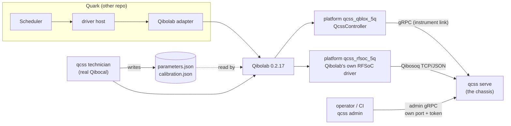
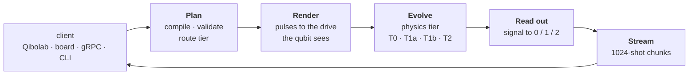

# QCSS: Quantum Control Stack Simulator

[](https://github.com/PratulDeshpande/qcss/actions/workflows/ci.yml)
[](https://pratuldeshpande.github.io/QCSS/)
[](LICENSE)
[](pyproject.toml)

📖 **Documentation:** [pratuldeshpande.github.io/QCSS](https://pratuldeshpande.github.io/QCSS/)

QCSS is a **virtual superconducting-qubit lab**. It stands in for real control electronics (Qblox,
Zurich Instruments SHFQC+, QICK on an RFSoC) and the chip behind them, so a quantum operating system
such as Quark can be developed and tested before, or alongside, real hardware. The OS reaches QCSS the
way it reaches a lab, through Qibolab, and cannot tell it is a simulator.

Three ideas make it useful rather than a toy:

1. **It enforces real hardware rules.** Every constant (timing grid, waveform memory, NCO range,
   feedback latency) comes from a YAML profile of a real instrument, and each value records its source.
2. **It hides the truth.** The chip drifts, has defects and hidden mixer and flux-line impairments. No
   client is ever handed the true parameters: the only calibration anyone sees is what the real Qibocal
   *measured* against the virtual lab.
3. **It behaves like a lab, not like a simulator.** Results come from fresh entropy, jobs take
   instrument time, the chip keeps aging while idle and survives restarts, and simulator controls live
   on a separate admin channel that the lab interface never exposes.

> **Status: alpha (0.1.0, with the virtual lab unreleased).** The simulator core, four physics tiers,
> the chassis, the Qibolab driver and platforms, the Qibosoq-compatible board, the native QICK board
> (Pyro4, tProc v1 and v2), the admin channel, the Qibocal technician and the QCSS Explorer dashboard are
> implemented and tested. The Qblox and QCoDeS faces are not built yet. See [Limits](#limits).

## The virtual lab



| Part | What it is | Where |
| --- | --- | --- |
| **Chassis** | The long-lived instrument process: physics, drift, persistence, pacing. A restart is an electronics reboot: uploaded settings are lost, the chip carries on. | `qcss serve`, `src/qcss/chassis.py` |
| **Qibolab driver** | `QcssController`, a thin gRPC client subclassing Qibolab's `Controller`. It holds no physics and never writes calibration. | `integrations/qcss_qibolab` (package `qcss-qibolab`) |
| **Platforms** | Ordinary Qibolab platform folders. `qcss_rfsoc_5q` uses Qibolab's unmodified RFSoC driver, so it differs from a lab's platform only by the board address. | `platforms/qcss_qblox_5q`, `platforms/qcss_rfsoc_5q` |
| **Board face** | A Qibosoq-compatible TCP server (4-byte length + JSON) on the chassis. | `qcss serve --board-listen`, `src/qcss/boards/qibosoq.py` |
| **Native QICK face** | A `QickSoc` stand-in served over Pyro4, as `qick.pyro.start_server` serves a real board, so unmodified `qick` programs (tProc v1 averager and v2 asm) run against the chip, with feedback and decimated readout. | `qcss serve --qick-ns host:port`, `src/qcss/boards/qick/` |
| **Technician** | Runs the real Qibocal (`qq run`, then an atomic install) on a schedule and on request. Its files are the only calibration Quark sees. | `qcss technician`, `src/qcss/technician/` |
| **Admin channel** | Scenario, mode and fault knobs on a separate address and token. | `qcss admin`, `proto/qcss/admin/v1/admin.proto` |
| **QCSS Explorer** | An operator dashboard that explains, visualizes and configures every layer, with an embedded virtual lab. It adds nothing to the lab link. | `integrations/qcss_dashboard` ([its README](integrations/qcss_dashboard/README.md)) |

### Run it

```bash
uv sync --extra qibocal --group lab --group dev     # Qibolab, Qibocal and the QCSS Qibolab driver
export QCSS_ADMIN_TOKEN=change-me

# 1. The chassis: instrument link on 50051, admin channel on 50052, chip state kept in ./state
qcss serve --profile qblox_cluster_5q --device transmon_5q --listen 127.0.0.1:50051 \
           --state-dir state --admin-listen 127.0.0.1:50052 --admin-token "$QCSS_ADMIN_TOKEN"

# 2. The technician (another terminal): on first boot every runcard is due; then it keeps to the schedule
export QIBOLAB_PLATFORMS=$PWD/platforms QCSS_QBLOX_5Q_ADDRESS=127.0.0.1:50051
qcss technician run --platforms-dir platforms --platform qcss_qblox_5q --reports reports \
                    --requests-dir requests --env QCSS_QBLOX_5Q_ADDRESS=127.0.0.1:50051

# 3. Any Qibolab client now uses the platform as it would a lab's
python -c "from qibolab import create_platform; p = create_platform('qcss_qblox_5q'); p.connect(); print(p)"
```

For the RFSoC platform add `--board-listen 127.0.0.1:6000` to `qcss serve` and set
`QCSS_RFSOC_5Q_ADDRESS=127.0.0.1:6000`. The qibosoq client has no numpy-2 release on PyPI, so install
it from a pinned commit: `uv pip install "qibosoq @ git+https://github.com/qiboteam/qibosoq@2c376278785e6ae8aae1f13d1b0b467e067aaf7d"`.

### How the virtual lab behaves

- **Calibration is measured, never handed over.**
  - The platforms start from "last cooldown" values: frequencies off the truth, an imperfect π
    amplitude, a fitted readout threshold. `scripts/make_platform_parameters.py` makes them.
  - The technician writes `parameters.json` and `calibration.json`. The calibration-set identity is the
    sha256 of those two files, exactly as for a real lab. The chassis never writes calibration.
  - Each `play` uploads the platform's settings and pins the job to them, so a recalibration in between
    ends the job `REJECTED` (`CALIBRATION_EPOCH`) instead of mixing two calibrations.
- **Time is wall time.** `--time-scale` (default 1) is lab seconds per wall second: the chip drifts
  while idle, and each job takes its upload latency plus shots × (sequence + relaxation) in wall time.
  `--time-scale 0` freezes the chip and runs jobs unpaced, for tests.
- **The chip persists.** With `--state-dir` the drift, defects, scenarios, lab clock and random state are
  saved as plain JSON every 60 s and at shutdown; downtime counts as lab time.
- **The lab link hides the simulation.**
  - Results come from fresh entropy; a job's `random_seed` is ignored unless the chassis runs
    `--deterministic`.
  - The operator picks the physics tier (`--tier`, default auto); a client's `requested_tier` is ignored.
  - `JobStatus` carries no tier or noise fidelity, there is no gRPC reflection (unless
    `--debug-reflection`), failures read like an instrument's, and `GetDeviceProperties` (the true
    T1/f01) is not served.
  - One job runs at a time, as on one chip.
- **Scenarios and faults stay on the admin channel.** For example `qcss admin kill 2`,
  `qcss admin drift 0 --df-hz 2e6`, `qcss admin fault reboot --duration 5`, `qcss admin truth`,
  `qcss admin inspect <job>`. None of this is reachable from the lab link.
- **Quark's L4 `request_calibration`** maps to `qcss technician request --scope device|quick|cz`: a
  lab-side spool, acknowledged with an expected completion time. Requests are served before routine
  calibrations; a failing runcard backs off and leaves the platform as it was.

### Technician schedule

| Runcard | Routines | Default period |
| --- | --- | --- |
| `quick.yml` | single-shot classification, Ramsey, T1, readout check | 4 h (`--quick-every`) |
| `full.yml` | resonator and qubit spectroscopy, Rabi, Ramsey, T1, T2, single shot, standard RB | 24 h (`--full-every`) |
| `cz.yml` | CZ chevron, `correct_virtual_z_phases`, `optimize_two_qubit_gate` | 7 days (`--cz-every`) |

The schedule runs on wall time. Every result is checked before it is installed: NaN or infinite values,
amplitudes beyond full scale and non-positive durations or frequencies are refused.

## How a job runs inside the chassis



1. **Plan (at `SubmitJob`).** Sweep points are expanded (or taken from `Job.program_points`, which the
   Qibolab driver fills in itself); every point is compiled and checked against the hardware profile
   (grids, minimum durations, waveform memory, NCO rules, acquisition limits, feedback timing including
   time of flight and routing latency, DAC saturation). Pulses are lifted to their actual unitaries and
   the job is routed to a fidelity tier. Refusals come back before a job id exists: `INVALID_ARGUMENT`
   for hardware violations, `FAILED_PRECONDITION` for a job the instrument cannot run or a stale
   calibration epoch.
2. **Render.** Each play is rendered on the generator's sample grid: frame phase from the NCO model
   (virtual Z, `set_phase`, `set_frequency`), the client's IQ correction, the hidden mixer truth and LO
   leakage, and for flux lines the client's predistortion followed by the hidden line response, kept
   as one continuous stream per port.
3. **Evolve.** The selected tier advances the quantum state under the rendered drive, at the chip's
   temperature (thermal start and upward jumps). Device parameters drift on the lab clock.
4. **Read out.** T2 integrates simulated resonator traces (T1 jumps, time of flight, quantum-efficiency
   noise) with the client's discriminator; the faster tiers use a confusion matrix derived from that
   same physical model, so every tier reports consistent readout error.
5. **Stream.** Results go out in fixed 1024-shot chunks whose random streams are keyed by
   (domain, sweep point, chunk), so with a fixed seed a job reproduces exactly for any worker count.
   Qubits are never silently reset between shots; leave `repetition_delay_ticks` unset to wait 10 × T1.

### Fidelity tiers

| Tier | Method | Use it for | Limit |
| --- | --- | --- | --- |
| **T0** | Classical bits with simple error odds | Scheduler and telemetry tests | No coherence |
| **T1a** | Stim stabiliser simulator, Pauli-twirled noise | Error correction, large Clifford circuits | Every pulse within 1 % of a Clifford |
| **T1b** | Statevector with exact amplitude damping, thermal | Gate-level circuits, up to 26 qubits | Leakage ≤ 3 %, no overlapping pulses on one qubit |
| **T2** | Multi-qutrit Lindblad master equation under the real pulses | Pulse calibration, Rabi, Ramsey, ZZ, CZ chevrons | 4 qutrits |
| T3 | Quantum trajectories | | Not built; requests are refused |

Auto routing prefers exact T1b up to 26 qubits and uses T1a only for scale or on request. Jobs whose
pulses leak more than 3 % out of the qubit subspace, or that overlap a drive and a flux pulse on the
same qubit, go to T2. QCSS **never downgrades silently**: a job no tier can honour is refused.

## Install

QCSS needs Python 3.12 or 3.13.

```bash
git clone https://github.com/PratulDeshpande/qcss.git
cd qcss
uv sync --group dev                                # simulator + tests, linting, protobuf generation
uv sync --extra qibocal --group lab --group dev    # plus the virtual lab (Qibolab, Qibocal, qcss-qibolab)
```

With pip (25.1 or newer for dependency groups): `python -m pip install -e ".[qibocal]" -e integrations/qcss_qibolab --group dev`.

<!-- AUTO-GENERATED from pyproject.toml: extras and dependency groups -->
| Name | Kind | Installs |
| --- | --- | --- |
| `qibolab` | extra | `qibolab==0.2.17`, `qibo` |
| `qibocal` | extra | `qibocal==0.2.6`, `qibolab==0.2.17`, `qibo` |
| `qick` | extra | `Pyro4`, `psutil` (the native QICK face; the `qick==0.2.370` client is a manual install) |
| `adapters` | extra | `qcodes`, `pyvisa`, `pyvisa-sim` (for the planned QCoDeS mirror) |
| `lab` | group | `qcss-qibolab` (editable, from `integrations/qcss_qibolab`) |
| `dev` | group | `grpcio-tools`, `pytest`, `pytest-xdist`, `hypothesis`, `anyio`, `cryptography`, `ruff`, `pyright==1.1.414`, `fastapi`, `uvicorn`, `httpx` (the Explorer bridge) |
<!-- END AUTO-GENERATED -->

## Quick start without the lab stack

`qcss run` simulates a job file in-process. Unlike the chassis it honours the job's seed and tier, which
makes it the tool for physics experiments and debugging.

```bash
qcss profile list                                  # built-in hardware profiles
qcss device show transmon_5q                       # the simulated chip
```

Save this as `job.json`. It plays a half-amplitude 20-sample square pulse (a π pulse at the default
Rabi rate) on qubit 0, then measures it:

```json
{
  "numShots": 200,
  "requestedTier": "FIDELITY_TIER_T1B_STATEVECTOR",
  "randomSeed": "7",
  "waveformLibrary": { "pi": { "shape": "WAVEFORM_SHAPE_SQUARE", "lengthSamples": 20 } },
  "main": { "instructions": [
    { "play": { "channelId": "xy_q0", "waveformId": "pi", "amplitude": 0.5 } },
    { "startTick": "24", "acquire": { "channelId": "ro_q0", "integrationTicks": "1000",
        "mode": "ACQUISITION_MODE_DISCRIMINATED", "resultKey": "q0" } }
  ] }
}
```

```bash
qcss validate job.json -p qblox_cluster_5q -d transmon_5q     # check only; prints violations with field paths
qcss run job.json -p qblox_cluster_5q -d transmon_5q          # simulate; a pi pulse gives mostly 1
qcss run job.json -d transmon_5q -t T2 -s 500 -o results.json # pulse-level physics, 500 shots, save results
```

Jobs are `qcss.v1.Job` messages: JSON or YAML using the protobuf JSON mapping, or binary `.pb`.

### The instrument link (gRPC)

`qcss serve` implements `qcss.v1.ControlService` (`SubmitJob`, `GetJobStatus`, `CancelJob`,
`StreamResults`, `GetCalibration`, `UpdateCalibration`, `DescribeDevice`) and the standard gRPC health
check. Since the virtual lab, this link is the internal one between `QcssController` and the chassis;
Quark reaches QCSS through Qibolab, not through it. `qcss remote ping|describe|calibration|run` and
`scripts/remote_smoke.py` exercise it.

Over this link a client calls `GetCalibration` and `UpdateCalibration(expected_epoch=n)`. The update
succeeds only if `n` is the current epoch (compare-and-swap). What it writes (drive frequency, mixer
correction, flux predistortion, readout rotation, threshold and delay) is applied on top of the device's
secret impairments from the device file's `faults:` block.

> **Security.** Every listener binds to loopback by default. A network bind needs TLS and a token
> (`qcss serve` refuses otherwise unless `--insecure`):
>
> ```bash
> qcss serve --host 192.168.1.20 --tls-cert server.pem --tls-key server.key --token "$QCSS_TOKEN"
> ```
>
> The admin channel has its own token, which must differ from the lab token and is required whenever
> the lab link has one. The Qibosoq board face has no TLS or token (neither has the real protocol), so
> a network bind needs `--insecure`. `scripts/make_dev_cert.py <ip>` makes a self-signed certificate.
> See [SECURITY.md](SECURITY.md).

**Testing from a second PC?** Start the server with a network bind as above, copy `server.pem` to the
client PC, then run `python scripts/remote_smoke.py --target <ip>:50051 --ca server.pem --token "$QCSS_TOKEN"`
there. It checks health, the device description, pulse and idle jobs, hardware-rule refusal, calibration
compare-and-swap, streaming, cancellation and token rejection, and prints one line per step.

## Command reference

<!-- AUTO-GENERATED from `qcss --help` -->
| Command | What it does |
| --- | --- |
| `qcss serve` | Run the chassis: the instrument link, and optionally the admin channel (`--admin-listen`), the Qibosoq board face (`--board-listen`) and the native QICK board (`--qick-ns`, `--qick-name`, `--qick-listen`, `--qick-firmware`, `--qick-start-ns`, `--qick-loopback`). Options: `--state-dir`, `--time-scale` (default 1.0), `--seed` (default entropy), `--deterministic`, `--tier auto\|t0\|t1a\|t1b\|t2`, `--workers`, `--tls-cert/--tls-key`, `--token`, `--admin-token`, `--insecure`, `--debug-reflection`. |
| `qcss admin kill\|revive <q>` | Lose a qubit (decays within ~100 ns, moves 200 MHz) or undo it. |
| `qcss admin drift <q>` | Step a qubit's frequency (`--df-hz`) and/or T1 (`--t1-factor`); steps accumulate. |
| `qcss admin tls\|burst <q>` | A TLS defect drifts into resonance, or a cosmic-ray burst hits now. |
| `qcss admin freeze` / `clear` | Stop or resume drift of the whole chip; remove every scenario. |
| `qcss admin mode` | Show or change `--time-scale`, `--deterministic/--realistic` and `--tier`. |
| `qcss admin truth` | The chip as it really is now (only the simulator knows it). |
| `qcss admin inspect <job>` | How a job ran: tier, noise fidelity, failure detail. |
| `qcss admin fault hang\|drop\|reboot\|slow-upload` | Make the instrument misbehave (`--count`, `--duration`); `clear-faults` removes pending ones. |
| `qcss technician run` | Keep a platform calibrated: requests first, then quick, full and CZ runcards as they come due. |
| `qcss technician request` | Ask for a calibration (`--scope quick\|device\|cz`); prints the acknowledgement and ETA. |
| `qcss remote ping\|describe\|calibration\|properties\|run` | Talk to a running server over the instrument link. |
| `qcss run` / `qcss validate` | Simulate or only check a job file in-process. |
| `qcss profile list\|show` / `qcss device ...` | Inspect hardware profiles and device files. |
<!-- END AUTO-GENERATED -->

Every `qcss admin` command takes `--target` (default `127.0.0.1:50052`), `--token`, `--ca` and
`--insecure`.

## Environment variables

<!-- AUTO-GENERATED from the code's environment lookups -->
| Variable | Read by | Meaning |
| --- | --- | --- |
| `QCSS_TOKEN` | `qcss serve`, `qcss remote`, `QcssController` | Bearer token of the instrument link |
| `QCSS_ADMIN_TOKEN` | `qcss serve`, `qcss admin` | Token of the admin channel (must differ from `QCSS_TOKEN`) |
| `QIBOLAB_PLATFORMS` | Qibolab, Qibocal, the acceptance harness | Folder holding the platform folders (`platforms/`) |
| `QCSS_QBLOX_5Q_ADDRESS` | `platforms/qcss_qblox_5q/platform.py` | `host:port` of the chassis instrument link |
| `QCSS_RFSOC_5Q_ADDRESS` | `platforms/qcss_rfsoc_5q/platform.py` | `host:port` of the board face |
<!-- END AUTO-GENERATED -->

## Hardware profiles, devices and platforms

| Kind | Where | Shipped |
| --- | --- | --- |
| **Profile** (one instrument: clock, ports, generators, grids, memory, acquisition limits, latencies) | `src/qcss/config/profiles/*.yaml` | `qblox_cluster_5q` (a drive and flux sequencer per qubit, five readout sequencers on one feedline), `qick_zcu216_5q` (a drive and flux DAC per qubit, muxed readout), `qick_zcu216_4q`, `zi_shfqc_5q`, `test_ideal_1q` |
| **Device** (the chip: frequencies, T1/T2, couplings, resonators, `dynamics`, hidden `faults`) | `src/qcss/config/devices/*.yaml` | `transmon_5q` (T_eff 60 mK), `test_ideal_1q` |
| **Platform** (a Qibolab platform folder: `platform.py`, `parameters.json`, later `calibration.json`) | `platforms/` | `qcss_qblox_5q`, `qcss_rfsoc_5q` |

Every profile value carries a `provenance` block (source URL, firmware version, `verified`). Values
marked `verified: false` (listed by `qcss profile show`) are calibration parameters, not facts.

## Project layout

```text
proto/qcss/v1/         the instrument link contract (the .proto files are the source of truth)
proto/qcss/admin/v1/   the admin channel contract
src/qcss/
  core/                integer-tick time base, random streams (entropy-seeded chassis), units, errors, bind checks
  config/              profile and device schemas, loader, YAML files
  ir/                  compiler, hardware-rule validator, frames, waveforms, saturation
  signal/              port renderer, stateful filters, predistortion, mixer model
  device/              drift, two-level defects, cosmic-ray bursts, lab clock, admin scenarios
  physics/             T0 / T1a / T1b / T2 engines, pulse lifter, tier router
  readout/             resonator model, integration, discriminators, surrogate readout
  feedback/            shot executor, feedback latency and time of flight
  timing/              discrete-event engine, instrument-time pacing, host latency, jitter
  runtime/             planner, runner, job manager, calibration store, state persistence
  adapters/            gRPC instrument link, admin server, instrument faults, error mapping
  boards/              the Qibosoq-compatible board face; boards/qick/ is the native QICK face (Pyro4 QickSoc)
  technician/          the Qibocal technician: runcards, schedule, atomic install
  chassis.py           the long-lived instrument process behind `qcss serve`
  client.py            QcssClient for the instrument link
  v1/, admin/v1/       generated protobuf and gRPC code (committed)
  cli.py               serve / admin / technician / remote / run / validate / profile / device
integrations/qcss_qibolab/   the Qibolab driver (`qcss-qibolab`)
integrations/qcss_dashboard/ QCSS Explorer: the FastAPI bridge (src/) and the React frontend (web/)
integrations/quark_qcss/     deprecated Quark-side gRPC driver (removed next release)
platforms/                   Qibolab platform folders for the virtual lab
scripts/                     gen_proto, make_platform_parameters, make_dev_cert, remote_smoke, qick_surface
tests/                       unit, oracles, cross_tier, integration, virtual_lab
```

## Development

```bash
python -m pytest -n 2               # the full suite; the virtual-lab tests skip without the lab stack
ruff check .                        # lint
pyright                             # type check against the lab venv (must report 0 errors)
python scripts/gen_proto.py         # regenerate src/qcss/v1 and src/qcss/admin/v1 after editing a .proto file
```

<!-- AUTO-GENERATED from `pytest --collect-only` (646 tests) -->
| Directory | Tests | What it proves |
| --- | --- | --- |
| `tests/unit/` | 309 | One file per module, plus Hypothesis property tests |
| `tests/oracles/` | 12 | Rabi, Ramsey, T1, Hahn echo, ZZ, CZ, phase fringes, flux offsets and chevrons against analytic formulas at 5σ |
| `tests/cross_tier/` | 4 | Tiers agree where their domains overlap |
| `tests/integration/` | 175 | gRPC end to end, chassis, admin channel, both board faces (Qibosoq and native QICK), technician, indistinguishability scan |
| `tests/virtual_lab/` | 10 | Acceptance through the path Quark takes: QASM in, Qibolab compile, counts out |
| `integrations/qcss_qibolab/tests/` | 13 | Translation, platform loading, calibration pinning |
| `integrations/qcss_dashboard/tests/` | 71 | The Explorer bridge: registry, config store, guarded API, live chassis, experiments, views, CLI |
| `integrations/quark_qcss/tests/` | 52 | The deprecated driver |
<!-- END AUTO-GENERATED -->

Markers: `slow` (long physics oracles), `stochastic` (statistical assertions), `virtual_lab` (end to end
through Qibolab against a chassis), `linux_only`. Physics-asserting fixtures pin a known-good chip seed;
the chassis itself always defaults to entropy. See [CONTRIBUTING.md](CONTRIBUTING.md) to get started.

## Limits

- No T3 (quantum trajectories) engine: T3 requests are refused rather than downgraded.
- T2 is limited to 4 qutrits. A flux pulse on one qubit pulls its neighbours into a 4-qutrit T2 run of
  about 17 s per sweep point, so a full CZ calibration (`cz.yml`) takes hours.
- The Qibolab driver refuses coupler flux, DC flux offsets and offset sweeps, and `drive12`; the board
  face refuses RAW (decimated) acquisition and nonzero DC bias. These are outside the Qibocal routines
  the virtual lab targets, so time-of-flight and flux-spectroscopy routines are unavailable.
- There is no ZI platform folder yet: the ZI profile has no flux lines and one sequencer per role.
- The Qblox (Q1Simulator) face and the QCoDeS mirror are not built yet.
- LO leakage is applied while a pulse plays, not as a continuous tone between pulses.
- Profile numbers marked `verified: false` are calibration parameters, not facts; the QICK profiles
  follow one example firmware build.
- One bearer token per channel; no per-user accounts or mutual TLS.

## Author and citation

QCSS is written and maintained by Pratul Deshpande ([@PratulDeshpande](https://github.com/PratulDeshpande)). If you use it in research or testing, cite it as in [CITATION.cff](CITATION.cff):

```bibtex
@software{deshpande_qcss,
  author  = {Deshpande, Pratul},
  title   = {{QCSS: Quantum Control Stack Simulator}},
  version = {0.1.0},
  url     = {https://github.com/PratulDeshpande/QCSS}
}
```

## License

Apache License 2.0. See [LICENSE](LICENSE) and [NOTICE](NOTICE).
